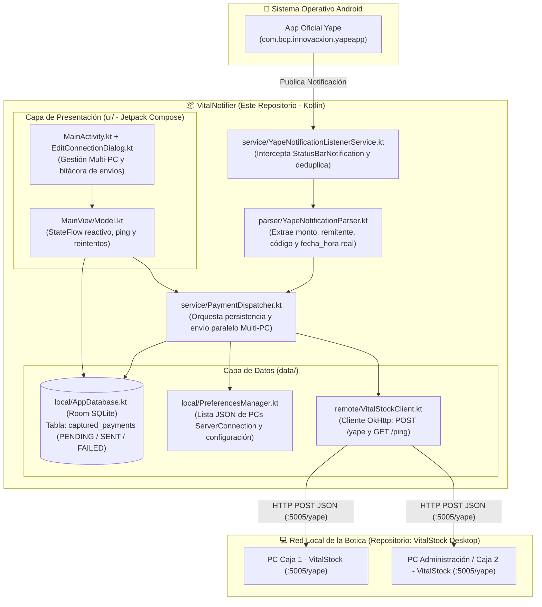

# 📱 VitalNotifier — Agente Móvil Android Capturador y Despachador de Pagos Yape para Botica


**VitalNotifier** es una aplicación móvil Android nativa (desarrollada en **Kotlin + Jetpack Compose + Room SQLite + OkHttp + Coroutines**) diseñada para operar en el teléfono de administración/cobro de una botica en Perú.

Su función principal es escuchar en segundo plano las notificaciones oficiales entrantes de **Yape** (`com.bcp.innovacxion.yapeapp`), extraer con precisión los datos de la transferencia (`remitente`, `monto`, `fecha_hora` exacta de la operación, `codigo_seg` y `mensaje_raw`), persistirlos localmente ante desconexiones de red y despacharlos en tiempo real mediante `HTTP POST` a una o múltiples computadoras donde corre el sistema de escritorio **[VitalStock](https://github.com/arocutipaluis/VitalStock)**.

---

## 🔗 Ecosistema Distribuido: Conexión Funcional con **VitalStock (Desktop)**

Este proyecto forma parte de la suite **VitalStock Suite**, compuesta por dos repositorios complementarios que operan bajo una arquitectura **Cliente-Servidor en Red Local (LAN)**:

| Repositorio | Plataforma / Stack | Rol en la Arquitectura Funcional del Sistema |
| :--- | :--- | :--- |
| **[VitalNotifier](https://github.com/arocutipaluis/VitalNotifier)** *(Este repositorio)* | Android Nativo (`Kotlin`, `Jetpack Compose`, `Room SQLite`, `OkHttp`) | **Agente Capturador y Despachador Móvil**: Corre en el celular donde está instalada la cuenta de Yape. Intercepta notificaciones oficiales de `com.bcp.innovacxion.yapeapp` (incluyendo notificaciones agrupadas de Android), captura el timestamp exacto del pago (`sbn.postTime` → `fecha_hora`), encola pagos en SQLite local si el teléfono sale del Wi-Fi y los envía en paralelo a todas las PCs registradas en la botica. |
| **[VitalStock](https://github.com/arocutipaluis/VitalStock)** *(Repositorio complementario)* | Windows Desktop (`Python 3`, `Tkinter`, `SQLite`, `OpenPyXL`, `PyStray`) | **Servidor Receptor y ERP de Botica**: Corre en segundo plano en la bandeja del sistema (`System Tray`) de las PCs de Caja y Administración. Escucha en `0.0.0.0:5005` (`/yape` y `/ping`), despliega notificaciones *Toast* apiladas con alerta sonora, almacena los pagos respetando la `fecha_hora` real enviada por `VitalNotifier` y gestiona inventario y compras. |

---

## 🏗️ Arquitectura del Sistema (`MVVM + Clean Layered Architecture`)



### Estructura de Carpetas
```text
VitalNotifier V1/
├── app/
│   ├── src/
│   │   ├── main/
│   │   │   ├── AndroidManifest.xml                  # Permisos BIND_NOTIFICATION_LISTENER, INTERNET
│   │   │   ├── res/xml/network_security_config.xml  # Habilita tráfico HTTP en red local (LAN)
│   │   │   └── java/pe/vitalstock/vitalnotifier/
│   │   │       ├── VitalNotifierApp.kt              # Inicialización de Room, OkHttp y Dispatcher
│   │   │       ├── data/
│   │   │       │   ├── model/
│   │   │       │   │   ├── YapePayment.kt           # DTO del contrato JSON con VitalStock
│   │   │       │   │   ├── PaymentEntity.kt         # Entidad Room SQLite (PENDING, SENT, FAILED)
│   │   │       │   │   └── ServerConnection.kt      # Modelo de conexión por PC (nombre, IP, puerto, activo)
│   │   │       │   ├── local/
│   │   │       │   │   ├── AppDatabase.kt           # Singleton Room Database
│   │   │       │   │   ├── PaymentDao.kt            # Consultas reactivas Flow y actualización de estados
│   │   │       │   │   └── PreferencesManager.kt    # Persistencia de múltiples PCs (ServerConnection)
│   │   │       │   └── remote/
│   │   │       │       └── VitalStockClient.kt      # Cliente HTTP (POST /yape y GET /ping)
│   │   │       ├── parser/
│   │   │       │   └── YapeNotificationParser.kt    # Motor Regex para formatos oficiales de Yape
│   │   │       ├── service/
│   │   │       │   ├── YapeNotificationListenerService.kt # Captura de notificaciones simples y agrupadas
│   │   │       │   └── PaymentDispatcher.kt         # Despacho concurrente a múltiples PCs y cola offline
│   │   │       ├── util/
│   │   │       │   ├── NotificationPermissionHelper.kt
│   │   │       │   └── SoundAlertHelper.kt
│   │   │       └── ui/
│   │   │           ├── MainActivity.kt              # Interfaz principal Jetpack Compose
│   │   │           ├── MainViewModel.kt             # Gestión de estado reactivo y reintentos
│   │   │           ├── components/
│   │   │           │   ├── EditConnectionDialog.kt  # Modal para agregar/editar PCs de la botica
│   │   │           │   └── PaymentItemCard.kt       # Tarjeta de estado de cada pago capturado
│   │   │           └── theme/
│   │   │               └── Theme.kt                 # Tema institucional Material 3
│   │   └── test/java/pe/vitalstock/vitalnotifier/
│   │       └── parser/YapeNotificationParserTest.kt # Suite de pruebas unitarias JUnit 4
│   └── build.gradle.kts
├── test_server/
│   ├── mock_vitalstock_server.py                    # Servidor mock en Python para pruebas aisladas
│   └── verify_parsing_patterns.py                   # Script de validación de expresiones regulares
├── docs/
│   └── ARQUITECTURA_Y_REQUERIMIENTOS.md             # Especificación formal de requerimientos y arquitectura
├── build.gradle.kts
└── settings.gradle.kts
```

---

## 📡 Contrato de Comunicación HTTP con **VitalStock**

### 1. Test de Conectividad (`GET /ping`)
Verifica que la computadora con **VitalStock** esté encendida y accesible en la red Wi-Fi de la botica:
- **URL**: `GET http://<IP_DE_LA_PC>:5005/ping`
- **Respuesta (`200 OK`)**:
  ```json
  {
    "status": "ok",
    "app": "VitalStock"
  }
  ```

### 2. Envío de Pago Capturado (`POST /yape`)
Por cada pago real detectado, **VitalNotifier** envía una petición `HTTP POST` a `http://<IP_DE_LA_PC>:5005/yape` con exactamente estos 5 campos:
```json
{
  "remitente": "JUAN PEREZ",
  "monto": 25.50,
  "fecha_hora": "15/10/2026 10:35:12",
  "codigo_seg": "1234",
  "mensaje_raw": "¡Te transfirieron S/ 25.50 de JUAN PEREZ! Cód: 1234"
}
```
> **Garantía de Integridad Temporal (`fecha_hora`)**: `VitalNotifier` obtiene `fecha_hora` directamente del `sbn.postTime` en que Android recibió la notificación de Yape. Si el celular sale de la botica (sin Wi-Fi local) y regresa horas después, al presionar **"Reintentar Pendientes"**, `VitalStock` registrará cada pago en su base de datos con la hora exacta en que ocurrió el Yape y no con la hora de reconexión.

---

## 🚀 Clonación, Compilación y Ejecución desde Cero (Guía para el Auditor)

### 1. Prerrequisitos
- **JDK**: Java 17 (incluido con Android Studio Ladybug / Koala o superior).
- **Android SDK**: API Level 34 (`compileSdk = 34`, `minSdk = 26`).

### 2. Clonar y Compilar el APK
```powershell
git clone https://github.com/arocutipaluis/VitalNotifier.git
cd VitalNotifier

# Compilar APK de depuración
.\gradlew.bat assembleDebug
```
El archivo instalable se generará en `app/build/outputs/apk/debug/app-debug.apk`.

### 3. Ejecutar Pruebas Unitarias Automatizadas (`JUnit 4`)
El repositorio incluye una suite exhaustiva de pruebas en `YapeNotificationParserTest.kt` que valida formatos oficiales del BCP, montos con miles/decimales, códigos de seguridad y rechazo de notificaciones publicitarias:
```powershell
.\gradlew.bat testDebugUnitTest
```

### 4. Prueba de Integración Local (Con VitalStock o Servidor Mock)
1. Inicie **[VitalStock](https://github.com/arocutipaluis/VitalStock)** en la PC (`python main.py --open`) o ejecute el servidor de prueba incluido:
   ```powershell
   python test_server/mock_vitalstock_server.py
   ```
2. En **VitalNotifier**, agregue la dirección IP local de la PC (puerto `5005`) y presione **"Probar Ping"**.
